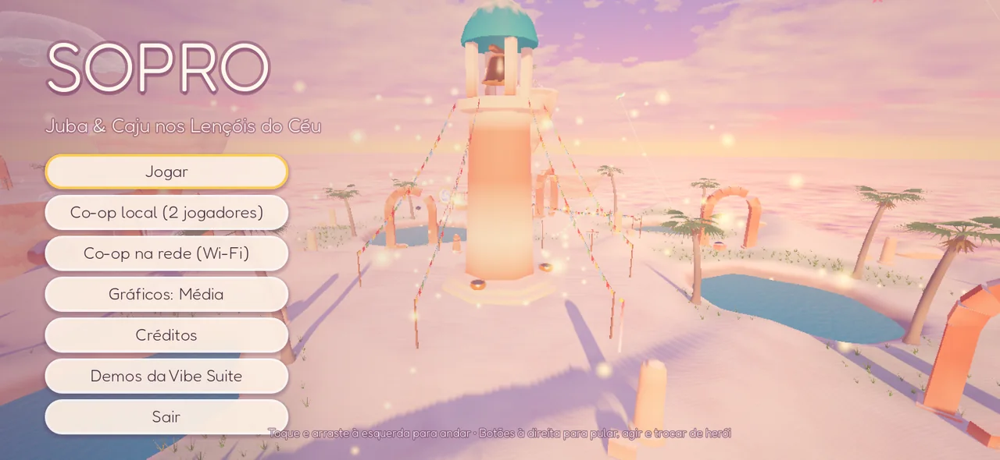
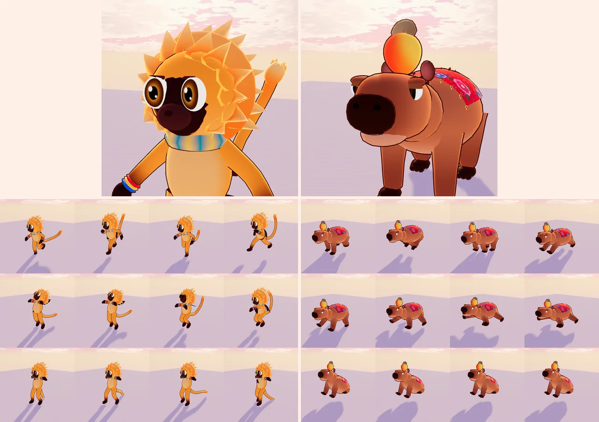
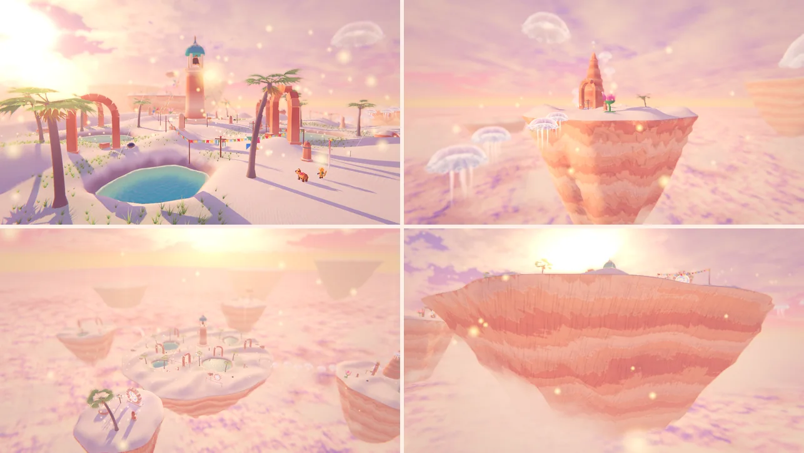

# SOPRO — Juba & Caju nos Lençóis do Céu

MVP de **aventura 3D co-op** feito com **Godot 4.7** + **Blender** (tudo gerado por código neste
repositório), pensado para **celular Android (Snapdragon, Vulkan)** e também jogável no PC.



> **Premissa.** As ilhas dos Lençóis do Céu flutuam graças ao *sopro* do grande vento — que
> adormeceu. Juba e Caju precisam achar as **3 Sementes de Sopro** e tocar o **Grande Sino** para
> acordar o vento.

## A dupla (personagens originais)

| | |
|---|---|
| **Juba** — mico-leão-dourado agitado, com juba de sol, cachecol turquesa e fitinhas do Bonfim nos pulsos. **Pulo duplo** (pirueta), **planar** com o cachecol que vira **pipa**, **giro** com o rabo, e **sobe nas costas do Caju**. | **Caju** — capivara tranquila com uma manta de **chita** e um **caju na cabeça** (que balança!). **Barrigada** (ground pound com onda de choque), **cabeçada**, **nada rápido**, **carrega o Juba** e o **catapulta** longe. Só ele afunda as **placas pesadas**. |



Modelados, riggados e animados **proceduralmente no Blender** (`game/blender/build_characters.py`):
malhas por partes com pesos de skinning calculados, esqueletos próprios (bípede com rabo/cachecol e
quadrúpede com orelhas/caju) e **23 animações** amostradas a 30 fps (andar, correr, pular, cair,
pousar, pirueta, planar, giro, carona, comemorar, dano, nadar; galope, barrigada, sentar...).

**Animação fluida no Godot:** `AnimationTree` com locomoção sincronizada (idle/andar/correr com a
mesma linha do tempo, velocidade do ciclo casada com a velocidade real), crossfades entre estados,
**física secundária** (`SpringBoneSimulator3D` no rabo, no cachecol, nas orelhas e no caju),
inclinação nas curvas e na aceleração, *squash & stretch* com mola, olhos procedurais que piscam,
**interpolação de física** (suave em telas de 90/120 Hz) e câmera com amortecimento.

## O mundo: "Lençóis do Céu" (semiaberto)

Inspirado nos **Lençóis Maranhenses**: dunas brancas com lagoas turquesa — só que flutuando sobre
um **mar de nuvens** ao pôr do sol, com festa junina, pipas, cata-ventos e águas-vivas do céu.



| Ilha | Como chegar | Desafio |
|---|---|---|
| **Ilha do Sino** (centro) | — | Torre do Grande Sino, lagoas, arcos de arenito, Breus |
| **Ilha das Águas-Vivas** (leste) | ponte de **águas-vivas trampolim** | subir a agulha de pedra quicando em espiral |
| **Ilha dos Cata-ventos** (norte) | **flor-canhão** | **placa normal + placa pesada** ao mesmo tempo abrem o **portão-flor**; corrente de ar até uma pedra flutuante |
| **Ilha da Fita** (oeste) | **fita de vento** (trilho que se desliza) | arena com 3 Breus guardando a semente |
| **Ilhota Secreta** (alto, sul) | **portal (fenda)** escondido num arco | chuva de lumes |

Qualquer ordem. **Lumes** (191) marcam caminhos e viram melodia ao serem coletados em sequência;
**totens** são pontos de retorno; cair no mar de nuvens devolve ao último totem.

## Visual e pós-processamento (renderer Mobile/Vulkan)

Shaders próprios em `game/shaders/`:

- **Céu** pastel (pêssego → rosa → lavanda) com halo largo, nuvens pintadas com borda dourada no
  contraluz e cirros — calculado no passe de **meia resolução** e fora do cubemap de radiância.
- **Areia** com **brilho de microfacetas** (glitter estilo *Journey/Sky*), ondulações do vento com
  anti-aliasing por derivada, sheen de contraluz, areia molhada e **arenito estratificado** na raiz.
- **Lagoas** com cor por profundidade, **cáusticas projetadas no fundo** (reconstruído do depth
  buffer), espuma na margem e brilho do sol — sem ler a tela (barato).
- **Mar de nuvens** iluminado pelo sol baixo, que **dissolve suavemente** a raiz das ilhas.
- Personagens **toon suave** (bandas + subsurface quente + rim de contraluz) com **contorno**.
- Águas-vivas iridescentes, folhagem translúcida com vento, bandeirinhas que tremulam, portal,
  fita de vento, feixes de luz, nuvens fofas, partículas de luz no ar.
- **Pós**: glow, ACES, névoa com *sun scatter* e perspectiva aérea, DOF de distância (Alta) e um
  passe de tela cheia com **raios de sol radiais**, gradação de "hora dourada", vinheta colorida,
  aberração cromática nas bordas e grão.

**Qualidade** (menu/pausa): *Baixa* (escala 72%, FXAA, sem sombras), *Média* (85%, MSAA 2×, sombras
2 cascatas até 45 m — padrão no celular) e *Alta* (100%, MSAA 4×, DOF, mais capim).

## Co-op

- **Solo:** você controla um herói e o outro segue pela **IA** (pula obstáculos, plana, sobe na
  carona, ocupa a placa livre quando você está na outra, reaparece se ficar para trás).
  **TROCAR** alterna entre Juba e Caju.
- **Co-op local:** o jogador 2 entra apertando **START** num controle (Bluetooth no celular, ou
  F2/setas no PC). Câmera compartilhada enquadra os dois.
- **Co-op na rede (Wi-Fi):** um aparelho **cria a sala** (Juba), o outro **procura/entra** (Caju).
  ENet + descoberta por broadcast UDP; dá para digitar o IP.

## Controles

| Ação | Toque (celular) | Teclado | Controle |
|---|---|---|---|
| Andar | arrastar à esquerda (analógico flutuante) | WASD | analógico esquerdo |
| Câmera | arrastar à direita | botão direito do mouse / setas | analógico direito |
| Pular / pulo duplo / planar (segure) | **PULAR** | Espaço | A |
| Giro (Juba) · cabeçada / barrigada no ar (Caju) | **AÇÃO** | J / clique | X / RT |
| Dupla: subir no Caju · catapultar · chamar | **DUPLA** | K / E | B |
| Trocar de herói (solo) | **TROCAR** | Tab / Q | Y / RB |
| Pausa | ⏸ | Esc | Start |

## Gerar o APK (Android)

```bash
python3 tools/build_android.py            # build/sopro-debug.apk (arm64, assinado com keystore de debug)
python3 tools/build_android.py --install  # + adb install -r no aparelho conectado
```

Precisa de Godot 4.7.x + export templates da mesma versão, Android SDK (`ANDROID_HOME`, com
`build-tools/*/apksigner`) e JDK 17+. O script cria o preset "Android" (renderer Mobile/Vulkan,
**paisagem com sensor**, tela cheia imersiva, permissões de rede para o co-op), exporta só os
recursos do jogo (sem as demos da suíte) e verifica a assinatura. Instalação manual: copie o APK
para o celular e abra (permita "instalar apps desconhecidos").

## Estrutura

| Pasta | Conteúdo |
|---|---|
| `game/main.tscn` | cena principal: o mundo ao fundo + menu (sem tela de carregamento) |
| `game/scripts/player/` | `Hero` (controlador), `HeroVisual` (animação), `PlayerInput`/`InputSources`, `CompanionAI`, `SoproParty` |
| `game/scripts/world/` | montagem da fase pela receita, props, lumes, interativos, Breus, Torre do Sino, decoração |
| `game/scripts/camera/` | câmera co-op |
| `game/scripts/ui/` | tema (Fredoka), HUD, controles de toque |
| `game/scripts/net/` | co-op na rede (ENet + descoberta) |
| `game/scripts/systems/` | autoloads `Game`, `Sfx`, `Fx` |
| `game/shaders/` | todos os shaders |
| `game/world/lencois.json` | **receita do mundo**: ilhas, lagoas, platôs e todo o conteúdo de jogo (edite e rode o jogo) |
| `game/blender/` | scripts Blender (ilhas, props, personagens) + `.blend` editáveis |
| `game/tools/` | áudio procedural, texturas, capturas, playtest e teste de rede |

### Regerar os assets

```bash
blender -b --factory-startup --python game/blender/build_world.py        # ilhas (lê lencois.json)
blender -b --factory-startup --python game/blender/build_props.py        # props
blender -b --factory-startup --python game/blender/build_characters.py   # Juba e Caju (+ .blend)
python3 game/tools/gen_textures.py && python3 game/tools/gen_audio.py     # texturas e sons (CC0)
```

### Testes e capturas

```bash
python3 tests/run_tests.py --game-only     # playtest automático (43 verificações) + co-op em rede
xvfb-run -a godot --path . --rendering-method mobile res://game/tools/capture.tscn -- --out /tmp/shots --views hero,aerial,east
xvfb-run -a godot --path . --rendering-method mobile res://game/tools/char_preview.tscn -- --hero juba --anims run,glide --out /tmp/prev
```

## Próximos passos sugeridos

Mais fases (o formato de receita já suporta), salvar progresso, áudio espacial com reverb por
área, IA de inimigos mais variada, lobby online (além da LAN), *gyro* para mirar a câmera e um
build release com keystore própria para a Play Store.
