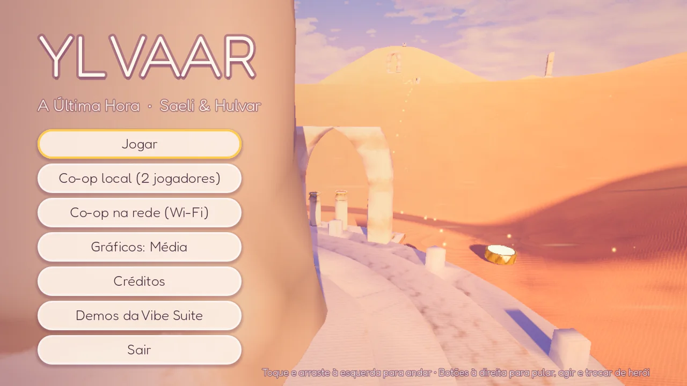
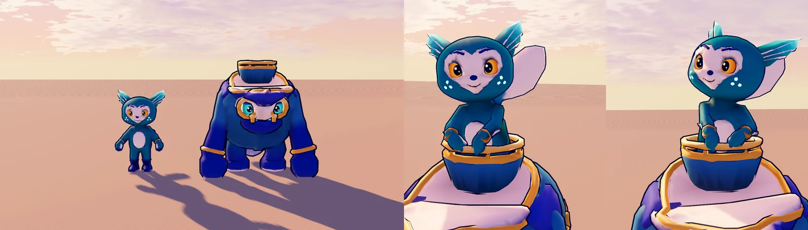
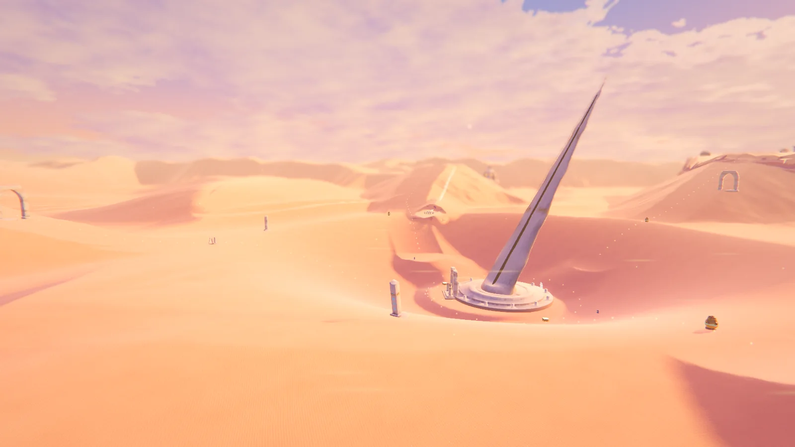
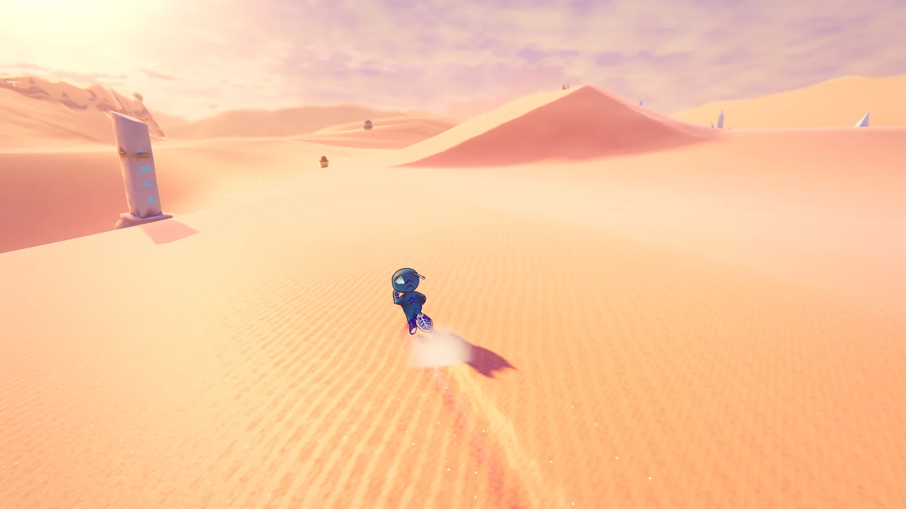

# YLVAAR — A Última Hora

MVP de aventura 3D **co-op** (solo com IA, co-op local e co-op em Wi-Fi) feito com **Godot 4.7 +
Blender**, tudo gerado por código neste repositório. Um mundo de fantasia **contínuo** — um mar de
areia com dunas no estilo de *Journey* — e uma dupla original, Saeli & Hulvar. Roda no celular
Android (renderer Mobile/Vulkan, Snapdragon).



> **Premissa.** Ylvaar é um mar de areia viva regido pela **Agulha de Vael**, um relógio de sol
> gigante. Os **Silentes** arrancaram as três **Pedras das Horas** e o tempo congelou uma hora antes
> do pôr do sol. Saeli e Hulvar precisam devolver as pedras ao **Portão de Vael** para que o sol,
> enfim, se ponha.

## A dupla: "Vela e Casco"

| **Saeli** (ágil) | **Hulvar** (forte) |
|---|---|
| Sprite-vela de pele verde-azulada, máscara-coração marfim, olhos âmbar e sardas que brilham. **Bater de Leques** (pulo duplo), **Planar** com os leques dos braços, **Rodopio**, **Cometa** (surfe de barriga na cauda-prancha) e **Embarcar** no cesto do Hulvar. | Antigo navio-guardião de porcelana esmaltada: olhos de escotilha, mandíbula de proa, punhos-marreta e uma âncora como cauda. **Salto Pesado**, **Aríete de Proa**, **Barrigada** (onda de choque), **Trenó de Quilha** nas dunas e o **Canhão do Ninho**: dispara a Saeli longe. Só ele afunda as **placas pesadas**. |

O glifo da popa do Hulvar tem 3 pontos — o mesmo triângulo das sardas da Saeli. Design completo em
[`game/design/herois.md`](design/herois.md).



## O mundo: Ylvaar (contínuo, semiaberto)

Um único terreno de ~1 km (heightfield com LOD contínuo), com dunas infinitas além da borda.
**Sobe pelo vento e pela pedra, desce pela areia**: a bacia central (o Berço, com a Agulha de Vael)
é o ponto mais baixo; urnas-canhão na borda lançam a dupla para as três zonas elevadas, e de cada uma
se volta **surfando**. Design em [`game/design/mundo.md`](design/mundo.md).

| Zona | Destaques |
|---|---|
| **A Proa** (partida) | duna mais alta; a **Primeira Descida** já é surfe, com a Agulha contra o sol |
| **O Berço** | bacia-funil com paredes surfáveis, a **Agulha de Vael** e o **Portão de Vael** |
| **Tolvaren** | colosso adormecido sob a areia; **Balança de Tolvaren**: placa pesada na palma + placa leve na corcunda abrem a gaiola da cabeça |
| **Véu de Saryth** | mesa com **cascatas de areia** contraluz; respiros de vento, urna e **arena de Silentes** |
| **Kesrin** | cratera de areia vitrificada com cristais; **fendas** e duas placas abrem o geodo |



### A areia (no espírito de *Journey*)
- **Contraste difuso** de Journey no relevo (normal com Y achatado), sombras tingidas pelo céu.
- **Ondulações do vento** com anti-serrilhado por derivadas, **grão**, **brilho especular "de oceano"**,
  **cintilância** de microfacetas, contraluz nas cristas e estratos de arenito nas encostas íngremes.
- **Rastros contínuos** atrás dos heróis (sulcos que o vento apaga em ~10 s) e **surfe nas dunas**
  automático em encostas ≥ 17°, mantendo o embalo ao saltar das cristas.
- **Cascatas de areia**, faixas de areia levadas pelo vento e dunas procedurais até o horizonte.



### As horas
Cada Pedra das Horas coletada baixa o sol uma "hora" (dourado → rosa → violeta) e enche um terço da
costura dourada da Agulha. O final — **"A Última Hora"** — leva o céu ao crepúsculo.

**Qualidade** (menu/pausa): *Baixa* (escala 72%, sem sombras, grade de terreno de 2 m), *Média*
(85%, MSAA 2×, sombras só perto da câmera — padrão no celular) e *Alta* (100%, MSAA 4×, DOF,
grade de 1 m).

## Co-op

- **Solo:** você controla um herói e o outro segue pela **IA** (pula obstáculos, plana, embarca,
  ocupa a placa livre, reaparece se ficar para trás). **TROCAR** alterna entre Saeli e Hulvar.
- **Co-op local:** o jogador 2 entra apertando **START** num controle (Bluetooth no celular, ou
  F2/setas no PC). Câmera compartilhada.
- **Co-op na rede (Wi-Fi):** um aparelho **cria a sala** (Saeli), o outro **procura/entra** (Hulvar).
  ENet + descoberta por broadcast UDP; dá para digitar o IP.

## Controles

| Ação | Toque (celular) | Teclado | Controle |
|---|---|---|---|
| Andar | arrastar à esquerda (analógico flutuante) | WASD | analógico esquerdo |
| Câmera | arrastar à direita | botão direito do mouse / setas | analógico direito |
| Pular / pulo duplo / planar (segure) | **PULAR** | Espaço | A |
| Rodopio (Saeli) · Aríete / Barrigada no ar (Hulvar) | **AÇÃO** | J / clique | X / RT |
| Dupla: embarcar · Canhão do Ninho · chamar | **DUPLA** | K / E | B |
| Trocar de herói (solo) | **TROCAR** | Tab / Q | Y / RB |
| Pausa | ⏸ | Esc | Start |

## Gerar o APK (Android)

```bash
python3 tools/build_android.py            # build/ylvaar-debug.apk (arm64, assinado com keystore de debug)
python3 tools/build_android.py --install  # + adb install -r no aparelho conectado
```

Precisa de Godot 4.7.x + export templates da mesma versão, Android SDK (`ANDROID_HOME`, com
`build-tools/*/apksigner`) e JDK 17+. O script cria o preset "Android" (renderer Mobile/Vulkan,
**paisagem com sensor**, tela cheia imersiva, permissões de rede para o co-op), exporta só os
recursos do jogo (incluindo os dados brutos do terreno) e verifica a assinatura.

## Estrutura

| Pasta | Conteúdo |
|---|---|
| `game/main.tscn` | cena principal: o mundo ao fundo + menu (sem tela de carregamento) |
| `game/world/world.json` | **receita do mundo**: seção `terrain` (gerador) + `content` (tudo o que é de jogo) |
| `game/world/world_terrain/` | dados gerados do terreno (`height.bin`, `normals.png`, `masks.png`, `meta.json`) |
| `game/scripts/world/` | terreno (`SandTerrain`, LOD contínuo), rastros, montagem do conteúdo, props, interativos, Silentes, Portão de Vael, atmosfera e horas |
| `game/scripts/player/` | `Hero` (controlador), `HeroVisual` (animação), `HeroDefs` (dados das personagens), `CompanionAI`, `HeroParty` |
| `game/scripts/camera/`, `ui/`, `net/`, `systems/` | câmera co-op, HUD/toque, co-op em rede, autoloads `Game`/`Sfx`/`Fx` |
| `game/shaders/` | areia (`sand_terrain`), personagens, props, cristal, céu, pós-processamento... |
| `game/blender/` | personagens (`build_saeli.py`, `build_hulvar.py`) e props (`build_world_props.py`) com o kit SDF (`lib/sdfkit.py`) |
| `game/design/` | documentos de design da dupla e do mundo |
| `game/tools/` | gerador de terreno, áudio, capturas, prévias, playtest e teste de rede |

### Regerar os assets

```bash
python3 game/tools/gen_terrain.py --preview                                   # terreno (lê world.json)
blender -b --factory-startup --python game/blender/build_world_props.py       # props
blender -b --factory-startup --python game/blender/build_saeli.py             # Saeli (+ .blend)
blender -b --factory-startup --python game/blender/build_hulvar.py            # Hulvar (+ .blend)
python3 game/tools/gen_textures.py && python3 game/tools/gen_audio.py          # texturas e sons (CC0)
```

**Kit SDF** (`game/blender/lib/sdfkit.py`): personagens e props são modelados como campos de
distância (uniões suaves, cascas de tecido, lâminas, pinturas com emissão, erosão por ruído),
malhados por *Surface Nets* + projeção exata, decimados (QEM) e coloridos por vértice com AO do
próprio campo; os pesos de skin saem das próprias partes.

### Testes e capturas

```bash
python3 tests/run_tests.py --game-only     # playtest automático (posições lidas da receita) + co-op em rede
xvfb-run -a godot --path . --rendering-method mobile res://game/tools/capture.tscn -- --out /tmp/shots --views "72,60,290>0,20,0"
xvfb-run -a godot --path . --rendering-method mobile res://game/tools/capture.tscn -- --out /tmp/shots --player --bot surf --views a,b,c
xvfb-run -a godot --path . --rendering-method mobile res://game/tools/model_preview.tscn -- --glb $PWD/game/assets/characters/saeli.glb --out /tmp/prev --anim run --t 0.25
```

## Próximos passos sugeridos

Mais zonas na mesma receita (a Arquivo soterrado, o coral de tubos), a correnteza de areia do
cânion, o espelhamento de luz em Kesrin, salvar progresso, áudio espacial com reverb por zona e um
time-lapse completo do sol no final.
