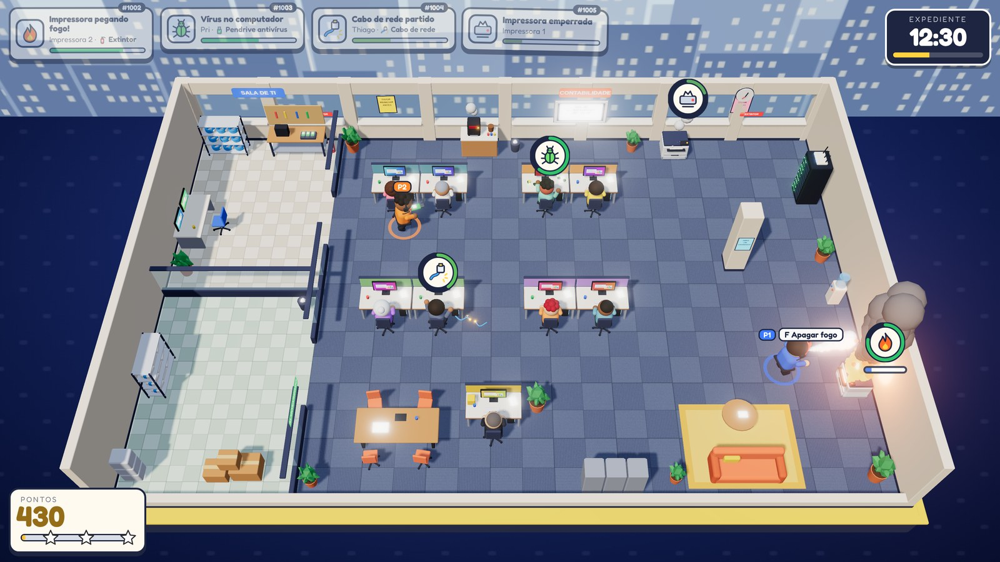
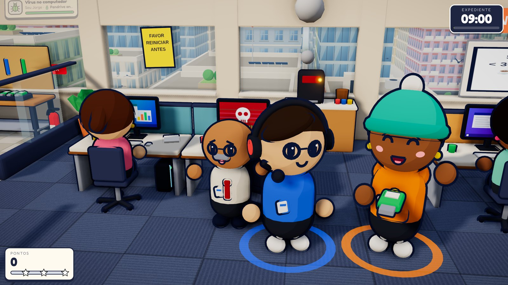
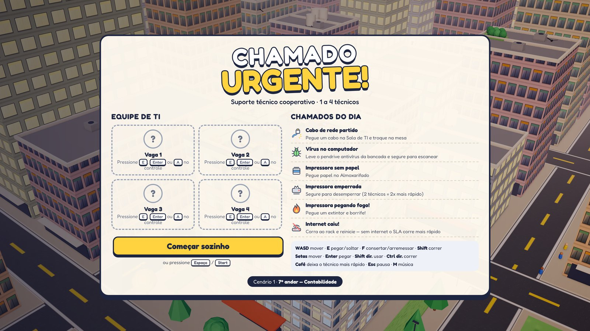
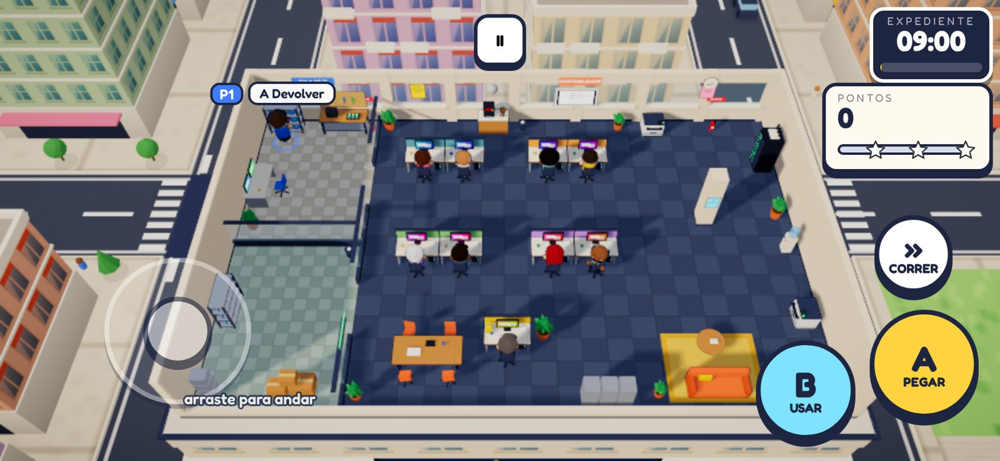

# Chamado Urgente!

Jogo cooperativo de **suporte técnico** em Three.js, no espírito de *Overcooked* / *Moving Out*:
você e seus colegas são o time de TI do escritório e precisam atender os chamados antes de estourar o **SLA**.



| Personagens | A cidade em volta (menu) | Celular (touch) |
|---|---|---|
|  |  |  |

## Rodar

```bash
cd games/chamado-urgente
npm install
npm run dev        # abre em http://localhost:5173
```

`npm run build` gera a versão estática em `dist/` (dá para hospedar em qualquer lugar).

## Como jogar (1 a 4 técnicos, coop local)

No menu, cada dispositivo entra apertando o botão de pegar; **Espaço**/**Start** começa.

| | Mover | Pegar/soltar | Consertar · borrifar · arremessar | Correr (empurra colegas!) |
|---|---|---|---|---|
| Teclado 1 | WASD | E | F (segurar) | Shift esq. |
| Teclado 2 | Setas | Enter | Shift dir. | Ctrl dir. |
| Controle | analógico | A | X / RT | B / RB |
| Touch | joystick (arraste na metade esquerda) | botão **A** | botão **B** | botão **Correr** |

**Esc** pausa · **M** liga/desliga a música. No celular, jogue na horizontal; o botão **II** pausa.

### Chamados do cenário 1 (7º andar — Contabilidade)

| Chamado | O que fazer |
|---|---|
| Cabo de rede partido | pegar cabo na **Sala de TI** e segurar F na mesa |
| Vírus no computador | levar o **pendrive antivírus** da bancada e escanear — se demorar, **espalha para o PC vizinho** |
| Impressora sem papel | buscar **resma** no **Almoxarifado** |
| Impressora emperrada | segurar F (dois técnicos juntos = 2x mais rápido) |
| Impressora pegando fogo | pegar um **extintor** e borrifar de longe |
| Internet caiu | reiniciar o **rack** — enquanto estiver fora, o SLA de todos os chamados corre 1,6x mais rápido |

Extras: **chamados VIP** do diretor (SLA menor, vale 1,5x), **combo** por chamados seguidos,
**café** dá velocidade por 10 s, itens podem ser **arremessados** e o colega pega no ar.
Expediente de 3 min (09:00 → 18:00), metas de 1 a 3 estrelas ajustadas ao tamanho da equipe.

### Direção de arte

Sombreamento *toon* em 3 tons + contorno preto (inverted hull) em personagens, itens e móveis
interativos. Personagens no estilo party game: corpo de feijão, cabeça grande, mãos e pés
flutuantes, olhos de pontinho e expressões gráficas (`^ ^` feliz, `O O` pânico, `X X` tonto).
A cidade é uma maquete pastel desfocada por *tilt-shift* para não competir com o jogo.

### Ambientação e "juice"

- **Cidade 3D** em volta do prédio (o escritório é o 7º andar): ruas com carros e pedestres, parques,
  telhados com caixas d'água e antenas, nuvens e pássaros. O menu é uma órbita em volta do prédio e a
  partida começa com a câmera descendo até o andar.
- **Ciclo do dia** ligado ao relógio do expediente: o sol cruza o céu, as sombras giram e, no fim da
  tarde, a luz fica dourada, as janelas da cidade, os postes e os faróis acendem e as luzes do escritório ligam.
- **Personagens** chibi com olhos que piscam, sobrancelhas e bocas por expressão (bravo, pânico, feliz,
  triste, concentrado, tonto). Funcionários levantam e gesticulam quando há problema, suam quando o SLA
  aperta, tomam café, se espreguiçam e conversam com o vizinho. Cada um tem visual próprio.
- **Balões de fala** ("Só cliquei no link do prêmio...", "Já reiniciei 3 vezes!"); a impressora fala em
  modo máquina ("NHAC NHAC NHAC") e os técnicos soltam bordões ("Desliga e liga de novo...").
- **Feedback de jogo**: hitstop e zoom ao fechar chamado, moedas voando até o placar, técnico comemora,
  tontura com estrelinhas ao levar trombada, rastro no dash, poeira dos passos, contorno no que dá para usar,
  vinheta vermelha com fogo, tensão nos últimos 10 s e estrelas "batendo" no relatório.
- **Pós-processamento**: oclusão de ambiente (GTAO), bloom, contorno, gradação de cor. Qualidade
  alta/média/baixa na pausa; se o FPS cair abaixo de ~45 o jogo reduz sozinho (`?q=low` força).

## Código

| Arquivo | Conteúdo |
|---|---|
| `src/config.js` | **balanceamento**: SLA, tempo de conserto, recompensa, ritmo dos chamados, metas |
| `src/level.js` | montagem do cenário (paredes, salas, mesas, estações) |
| `src/stations.js` | mesas, impressoras, rack, prateleiras, café e os visuais de cada problema |
| `src/tickets.js` | geração de chamados, SLA, vírus espalhando, internet fora |
| `src/player.js` · `src/items.js` | técnicos (movimento, dash, interação) e itens (física, arremesso) |
| `src/toon.js` | material toon e contorno |
| `src/characters.js` · `src/lines.js` | personagens (rosto, expressões, piscar, acessórios) e falas |
| `src/city.js` | cidade externa, trânsito, nuvens/pássaros e o ciclo do dia (luz, céu, janelas) |
| `src/models.js` · `src/textures.js` · `src/fx.js` | modelos procedurais, texturas em canvas, partículas |
| `src/ui.js` · `src/icons.js` · `src/audio.js` | HUD/marcadores, ícones SVG, sons e música sintetizados |

Tudo é procedural (sem arquivos de modelo/áudio externos).

## Testes

```bash
npm run build && npx vite preview --port 4173 &
npm test           # menu → entrar 2 jogadores → cabo → fogo → arremesso → vírus/internet → relatório
node scripts/touch_test.cjs   # celular emulado: joystick e botões
```
