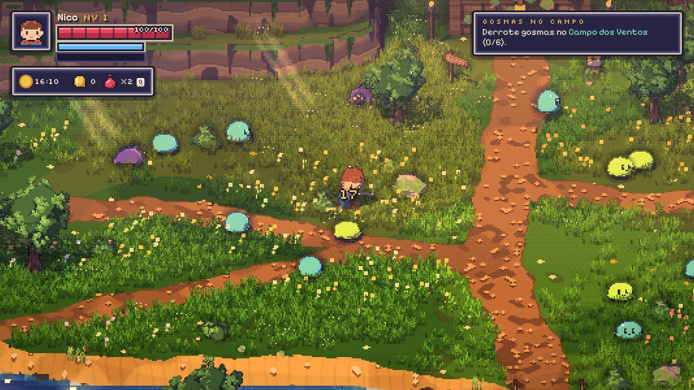
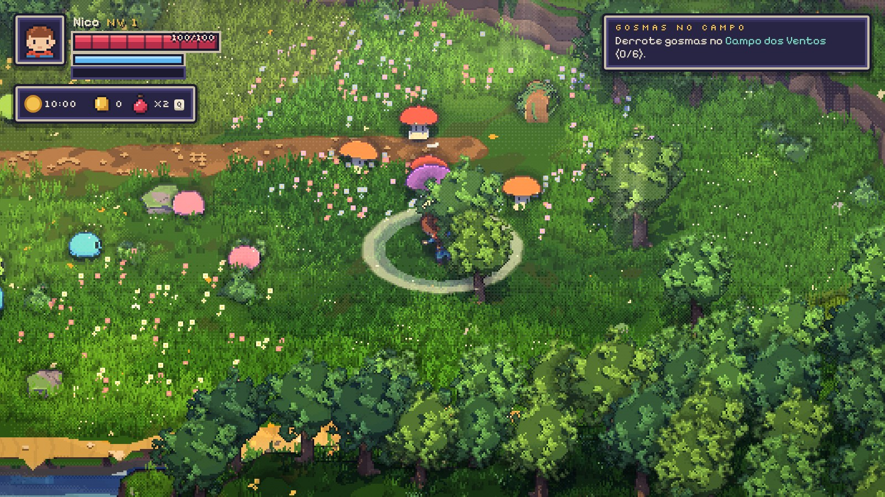
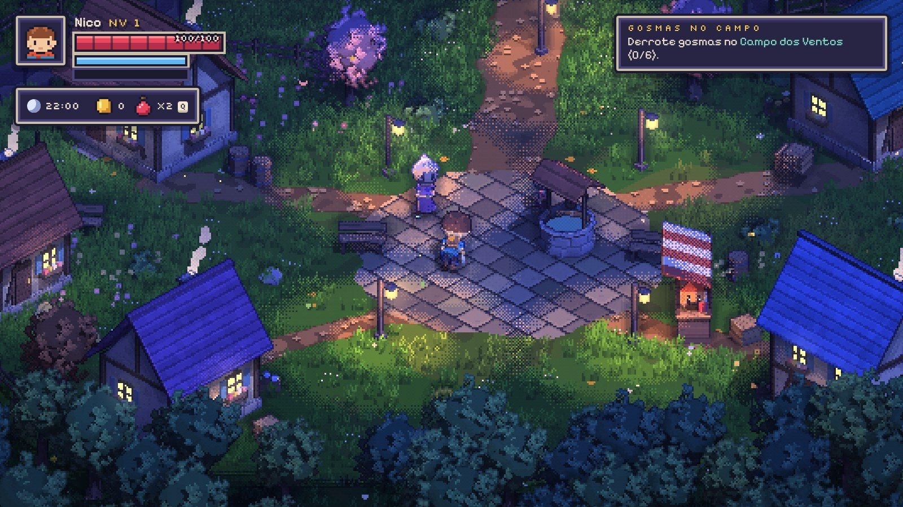
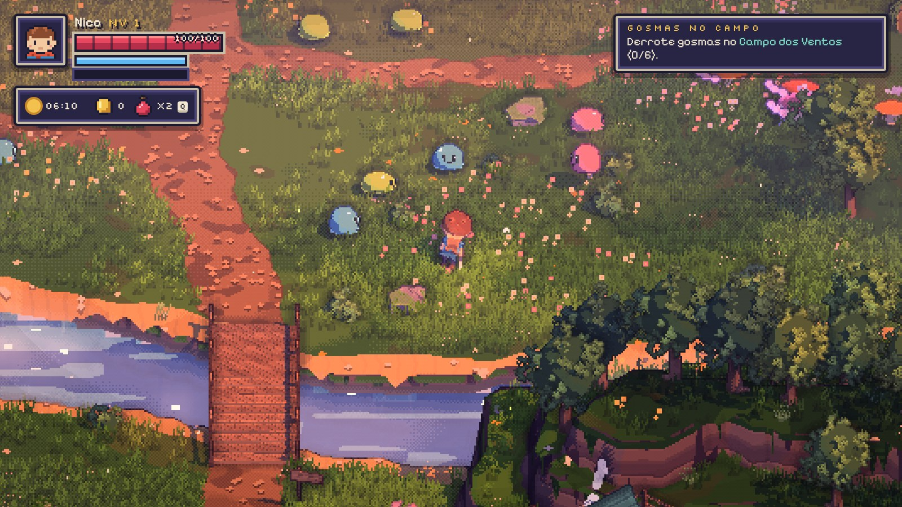
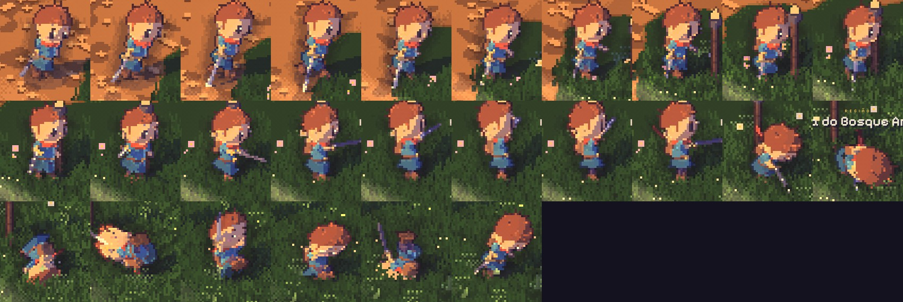
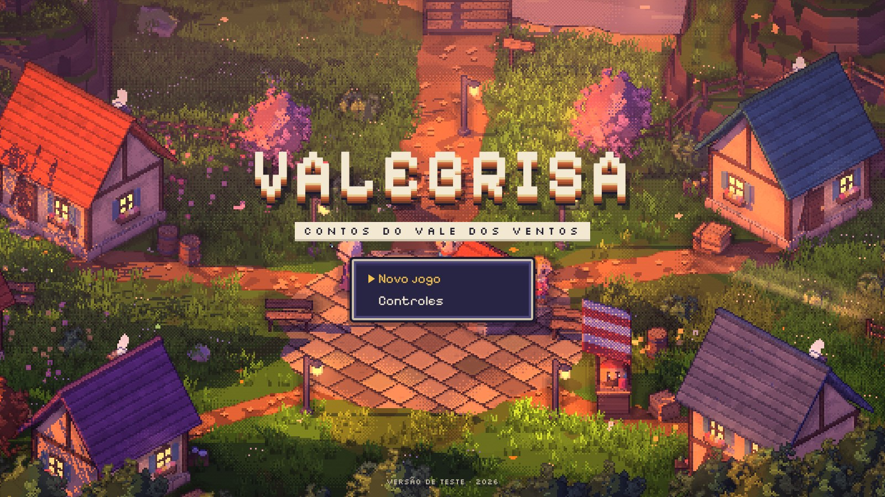
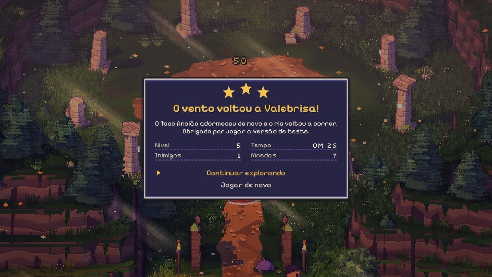

# Valebrisa — contos do vale dos ventos

RPG de ação **isométrico em 3D com cara de pixel art**, no espírito de *Secrets of Grindea*
(combate rápido com combo, golpe carregado, rolamento, inimigos e chefe com ataques telegrafados),
com cenário em "diorama" e linguagem visual de JRPG 16-bit. Versão de teste jogável no navegador.


| Combate no fim de tarde | Vale dos Cogumelos (giro carregado) | Toco Ancião (chefe) |
|---|---|---|
|  |  |  |

| Noite na vila (lampiões, janelas, bloom) | Amanhecer com névoa | Celular (toque) |
|---|---|---|
|  |  |  |

Quadros da animação (caminhada, combo com antecipação e follow-through, rolamento):



| Título (pôr do sol) | Final |
|---|---|
|  |  |

## Rodar

```bash
cd games/valebrisa
npm install
npm run dev        # http://localhost:5173
npm run build      # versão estática em dist/ (caminhos relativos: hospeda em qualquer lugar)
```

Teste automatizado (missão inteira, do título ao final):

```bash
npm run build && npx vite preview --port 4173   # em outro terminal
npm test
```

## Como jogar

| Ação | Teclado | Controle | Toque |
|---|---|---|---|
| Mover | WASD / setas | analógico / direcional | joystick (metade esquerda) |
| Atacar — combo de 3 golpes | J · Z · clique | A | **ATK** |
| Giro carregado | segurar ataque | segurar A | segurar **ATK** |
| Rolar (invulnerável) | Espaço · K · Shift | B | **ROLA** |
| Lâmina de vento (12 de energia, atravessa inimigos) | L · X · botão direito | X | **VENTO** |
| Poção (cura 50%) | Q · C | Y | **POÇÃO** |
| Falar / ler / abrir | E · Enter (ou atacar perto) | A | **ATK** |
| Pausa · música | Esc · M | Start | **II** |

Na pausa dá para trocar o tamanho do pixel (auto/2x/3x/4x), ligar/desligar os contornos e fixar a **hora do dia**
(ciclo, manhã, meio-dia, tarde, pôr do sol, noite). Também dá para abrir direto numa hora: `?hora=noite`.
O progresso é salvo no navegador (nível, moedas, poções e etapa da missão).

### A missão da versão de teste (~15 min)

1. **Vó Amora** (praça) conta que o vento parou e as **gosmas** tomaram o Campo dos Ventos — derrote 6.
2. Ela explica que o **Toco Ancião** acordou no Bosque Antigo; o portão só abre com a **Runa do Bosque**.
3. No **Vale dos Cogumelos** (leste, sobe pela rampa), raízes prendem o baú até você derrotar os **fungões** e o **Fungão-rei**.
4. Leve a runa ao **portão** ao norte (a guarda **Rubi** está lá).
5. **Toco Ancião** na Clareira Antiga: a arena se fecha com espinhos e ele alterna padrões —
   raízes que brotam onde há **aviso vermelho** no chão, chuva de sementes em anel, **pancada** com onda de choque
   (depois dela fica **atordoado** e toma 50% a mais de dano) e mergulho no solo para emergir perto de você.
   Com metade da vida ele fica furioso (olhos vermelhos, padrões mais rápidos, invoca gosmas).
6. Volte à vila e conte à Vó Amora.

Extras: **Tião** vende poções (15 moedas), **Seu Bento** pesca no lago do oeste e dá uma poção,
**Pipa** corre pela praça dando dicas. Inimigos deixam moedas, corações e orbes de energia; acampamentos do campo
reaparecem depois de um tempo (bom para subir de nível).

| Inimigo | Comportamento | Como lidar |
|---|---|---|
| Gosma (azul, lima, rosa) | pula atrás de você; agacha e treme antes do bote | role para o lado no tremor, contra-ataque no pouso |
| Fungão / Fungão-rei | mantém distância, infla o chapéu e solta 3 esporos | aproxime-se rolando entre os esporos |
| Besouro-chifre | mira (faixa vermelha no chão) e investe em linha reta | saia da faixa; se ele bater em algo fica tonto (dano x1,5) |
| Toco Ancião | padrões telegrafados em sequência | leia os avisos, puna depois da pancada |

## Direção de arte — "pixel art 3D"

O objetivo é parecer pixel art desenhada à mão, não um 3D genérico com filtro. Pesquisa e referências
em [`docs/referencias.md`](docs/referencias.md).

**Base do pixel**
- Resolução interna baixa (~300 px de altura, escala inteira) e câmera ortográfica isométrica **presa ao grid
  de pixels**; o resto subpixel vira deslocamento na ampliação → nada "nada" ao andar.
- Contornos por profundidade + normais (silhueta na *própria cor* escurecida, brilho só em arestas convexas).

**Grama e folhagem em sprites (técnica t3ssel8r)**
- Atlas de pixel art 16x16 desenhado proceduralmente (`texgen.js`): 8 tufos de grama (com flores e trevos),
  8 cachos de folhas, 8 de agulhas de pinheiro, juncos com taboa e samambaias.
- ~50 mil tufos virados para a câmera em escala **1:1 com o pixel do jogo**, cor tirada do terreno na raiz,
  luz e sombra do chão, **rajadas de vento** que passam em ondas clareando as pontas, e a grama **se dobra**
  quando o herói passa. Densidade varia (gramado alto × chão aparecendo).
- Copas de árvores e arbustos são nuvens de **cartões de folhas** sobre um miolo escuro, com normais esféricas
  (sombreado redondo) e **sombra salpicada** no chão (o recorte das folhas vai para o shadow map).

**Iluminação dinâmica**
- **Ciclo de dia** (24 min reais): sol que nasce à direita e se põe à esquerda (sombras giram), cores de céu,
  rebatida, sol e realce interpoladas por hora; **lua** à noite.
- Sombreamento toon próprio: N·L × shadow map × sombra de nuvem → 3 faixas com hue shift (sombra fria vinda
  do céu, rebatida quente embaixo, luz na cor do sol, realce mais quente), dither Bayer só na fronteira.
- **Luzes pontuais em anéis** (até 12 por quadro, escolhidas pela distância): lampiões, janelas, fogueira e
  tochas que acendem ao anoitecer e tremulam; luz da lâmina de vento, dos golpes, do level up, do baú, da
  pancada do chefe e da poção; lanterna do herói à noite. **Rim light** nos personagens.
- **Raios de sol** entre as árvores alinhados à direção do sol (manhã e fim de tarde).

**Pós-processamento (HDR)**
- Cor em meio-float → **bloom** (limiar + borrão separável) em janelas, lampiões, fogo, vagalumes e brilhos da água.
- **Oclusão de ambiente** por vincos na profundidade (base de paredes, árvores e penhascos), em degraus.
- **Névoa de altura** com fiapos animados (amanhecer/noite no vale do rio) + **neblina de profundidade**.
- **Color grading por hora**: exposição, split toning (sombras/realces), contraste, saturação, lift/gain;
  compressão de altos que preserva o matiz; vinheta em degraus.

**Texturas e acabamento**
- Padrões procedurais em pixel por material: tábuas com veios e nós, reboco com manchas e sujeira na base,
  blocos de pedra com chanfro, telhas em escama, casca com sulcos, rocha com rachaduras e **musgo no topo**.
- Terreno: grama em 3 tons com manchas secas, terra com pedrinhas (luz + sombra), areia com marolas e conchas,
  praça com pedras chanfradas, penhascos com estratos, raízes penduradas e musgo na borda.
- Água transparente por profundidade, reflexo de céu e nuvens, correnteza, **cáusticas no leito**,
  **brilhos de sol** (bloom) e **espuma que vai e volta** na margem.

**Personagens e animação fluida (12 princípios da Disney, `anim.js`)**
- Rig articulado (quadril, coluna, peito, cabeça, braço/antebraço/mão, coxa/canela/pé) com formas arredondadas,
  olhos grandes com brilho, sobrancelhas e boca expressivas; inclinação "de sprite" para a câmera, para o rosto
  ler bem de cima.
- **Tweens com easing por segmento** (slow in/slow out) e **antecipação → golpe → follow-through → recuperação**
  em todos os ataques, giro, rolamento, magia, dano, morte, aceno e comemoração.
- **Molas amortecidas por articulação** (overlapping action): cada parte tem rigidez própria, então quadril, peito,
  mãos e cabeça chegam em tempos diferentes; virar é suave (sem travar em 8 direções).
- **Squash & stretch** com volume preservado em mola "gelatina" (herói, gosmas, fungões).
- **Caminhada procedural** com contato/passagem, quadril subindo e descendo, torção e contra-rotação dos ombros,
  braços e pés em arco; vira corrida com a velocidade; inclinação na aceleração e nas curvas.
- **Ação secundária**: cachecol em corrente, antena de cabelo, maria-chiquinha, saia, capa, nó da bandana e chapéu
  de mago com física; respiração, troca de peso, piscadas, NPCs que acompanham o herói com o olhar.

**Game feel**
- Hitstop, tremor de câmera em pixels inteiros, partículas cúbicas, números de dano, avisos vermelhos que enchem
  até o impacto.
- Interface de JRPG 16-bit (fonte pixel embutida, retratos e ícones desenhados no código, relógio do dia) e
  áudio 100% sintetizado.

## Código

| Arquivo | O quê |
|---|---|
| `src/render.js` | pipeline pixel-art: alvos de baixa resolução (HDR), passe de normais, contornos, AO, névoa, bloom, color grading |
| `src/lighting.js` | ciclo de dia (sol/lua, cores, névoa, grading por hora) e luzes pontuais dinâmicas |
| `src/texgen.js` | atlas de sprites em pixel art (grama, flores, folhas, agulhas, juncos, samambaias) |
| `src/materials.js` | material toon com iluminação própria: faixas com hue shift, luzes em anéis, rim, padrões de textura, vento |
| `src/world.js` | campo de alturas em terraços, trilhas/rampas, rio, ponte, colisão, shaders do terreno e da água |
| `src/props.js` | árvores e arbustos de cartões de folha, pedras, casas, poço, barraca, cercas, portão, ruínas, fogueira, tochas |
| `src/grass.js` | grama em sprites (vento, rajadas, dobra ao passar), flores, juncos e samambaias |
| `src/characters.js` | personagens articulados (herói, NPCs) e inimigos (gosma, fungão, besouro, Toco Ancião) |
| `src/anim.js` | animação procedural: molas, easing, trilhas de poses-chave, caminhada, física secundária |
| `src/entities.js` | herói (combo, carga, giro, rolamento, magia), IA dos inimigos e do chefe, coletáveis, projéteis |
| `src/fx.js` | partículas, cortes, ondas de choque, avisos no chão, números de dano |
| `src/ui.js` · `src/pixelart.js` | HUD, diálogos com máquina de escrever, menus, toque; pixel art em strings |
| `src/audio.js` · `src/input.js` | sons/música sintetizados; teclado, mouse, controle e toque |
| `src/main.js` | mundo, missão, NPCs, acampamentos, chefe, áreas, salvar/carregar, laço do jogo |

Para testes automatizados existe `window.__game` e `window.__step(n)` (passo determinístico) e o parâmetro
`?fast` (relógio acelerado em navegadores sem GPU).
