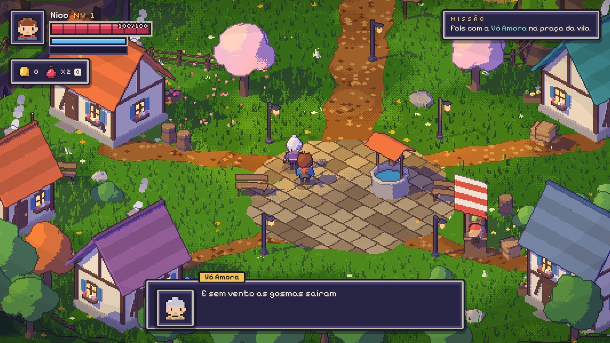
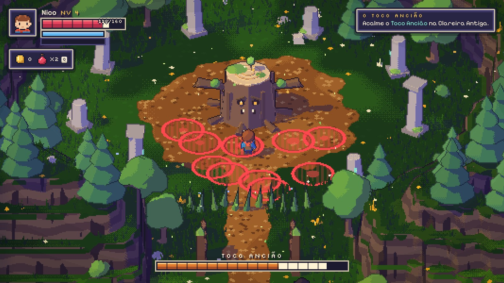
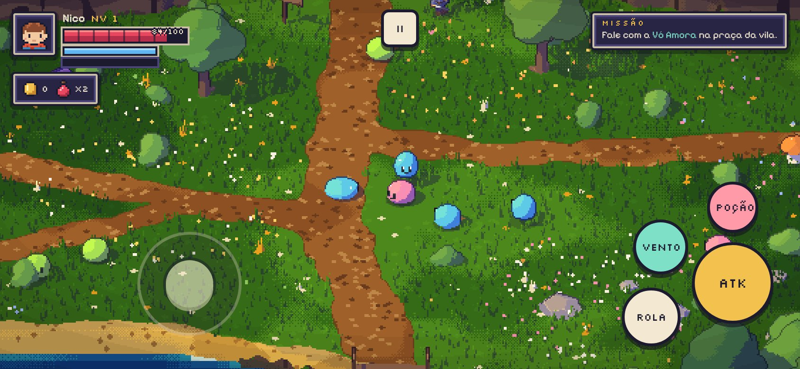

# Valebrisa — contos do vale dos ventos

RPG de ação **isométrico em 3D com cara de pixel art**, no espírito de *Secrets of Grindea*
(combate rápido com combo, golpe carregado, rolamento, inimigos e chefe com ataques telegrafados),
com cenário em "diorama" e linguagem visual de JRPG 16-bit. Versão de teste jogável no navegador.



| Combate no campo | Vale dos Cogumelos (giro carregado) | Toco Ancião (chefe) |
|---|---|---|
|  |  |  |

| Título | Final | Celular (toque) |
|---|---|---|
|  |  |  |

## Rodar

```bash
cd games/valebrisa
npm install
npm run dev        # http://localhost:5173
npm run build      # versão estática em dist/ (caminhos relativos: hospeda em qualquer lugar)
```

Teste automatizado (missão inteira, do título ao final):

```bash
npm run build && npx vite preview --port 4173   # em outro terminal
npm test
```

## Como jogar

| Ação | Teclado | Controle | Toque |
|---|---|---|---|
| Mover | WASD / setas | analógico / direcional | joystick (metade esquerda) |
| Atacar — combo de 3 golpes | J · Z · clique | A | **ATK** |
| Giro carregado | segurar ataque | segurar A | segurar **ATK** |
| Rolar (invulnerável) | Espaço · K · Shift | B | **ROLA** |
| Lâmina de vento (12 de energia, atravessa inimigos) | L · X · botão direito | X | **VENTO** |
| Poção (cura 50%) | Q · C | Y | **POÇÃO** |
| Falar / ler / abrir | E · Enter (ou atacar perto) | A | **ATK** |
| Pausa · música | Esc · M | Start | **II** |

Na pausa dá para trocar o tamanho do pixel (auto/2x/3x/4x) e ligar/desligar os contornos.
O progresso é salvo no navegador (nível, moedas, poções e etapa da missão).

### A missão da versão de teste (~15 min)

1. **Vó Amora** (praça) conta que o vento parou e as **gosmas** tomaram o Campo dos Ventos — derrote 6.
2. Ela explica que o **Toco Ancião** acordou no Bosque Antigo; o portão só abre com a **Runa do Bosque**.
3. No **Vale dos Cogumelos** (leste, sobe pela rampa), raízes prendem o baú até você derrotar os **fungões** e o **Fungão-rei**.
4. Leve a runa ao **portão** ao norte (a guarda **Rubi** está lá).
5. **Toco Ancião** na Clareira Antiga: a arena se fecha com espinhos e ele alterna padrões —
   raízes que brotam onde há **aviso vermelho** no chão, chuva de sementes em anel, **pancada** com onda de choque
   (depois dela fica **atordoado** e toma 50% a mais de dano) e mergulho no solo para emergir perto de você.
   Com metade da vida ele fica furioso (olhos vermelhos, padrões mais rápidos, invoca gosmas).
6. Volte à vila e conte à Vó Amora.

Extras: **Tião** vende poções (15 moedas), **Seu Bento** pesca no lago do oeste e dá uma poção,
**Pipa** corre pela praça dando dicas. Inimigos deixam moedas, corações e orbes de energia; acampamentos do campo
reaparecem depois de um tempo (bom para subir de nível).

| Inimigo | Comportamento | Como lidar |
|---|---|---|
| Gosma (azul, lima, rosa) | pula atrás de você; agacha e treme antes do bote | role para o lado no tremor, contra-ataque no pouso |
| Fungão / Fungão-rei | mantém distância, infla o chapéu e solta 3 esporos | aproxime-se rolando entre os esporos |
| Besouro-chifre | mira (faixa vermelha no chão) e investe em linha reta | saia da faixa; se ele bater em algo fica tonto (dano x1,5) |
| Toco Ancião | padrões telegrafados em sequência | leia os avisos, puna depois da pancada |

## Direção de arte — "pixel art 3D"

O objetivo é parecer pixel art desenhada à mão, não um 3D genérico com filtro. Pesquisa e referências
em [`docs/referencias.md`](docs/referencias.md). O que faz o visual funcionar:

- **Resolução interna baixa** (~300 px de altura, escala inteira na tela) e câmera ortográfica isométrica
  **presa ao grid de pixels**; o resto subpixel vira deslocamento na ampliação → nada "nada" ao andar.
- **Contornos por pós-processamento** (profundidade + normais em um segundo passe): silhueta escurecida na
  *própria cor* (não preta) e **brilho só nas arestas convexas** — a técnica popularizada por t3ssel8r.
- **Sombreamento em 3 faixas com hue shift**: a faixa do meio é exatamente o hex da paleta (gestão de cor
  desligada), a sombra puxa para azul/lilás e a luz para amarelo; dither Bayer 4x4 de 1–2 px na fronteira.
- **Paleta escolhida à mão** por material (grama em 3 tons, terra, areia, pedra, telhados) e terreno com
  padrões em espaço de mundo (pedrinhas, trevos, juntas da praça, estratos do penhasco com musgo no topo).
- **Grama de verdade**: ~22 mil tufos (≈90 mil lâminas) instanciados que usam a cor e a luz do chão na raiz (parecem parte do
  chão) e balançam no vento, sem contorno. Sombras de nuvens passando.
- **Copas "fofas"**: bolhas de icosaedro deformadas com normais esféricas → sombreado redondo e limpo.
- **Personagens chibi** de primitivas, direção travada em 8 lados e poses amostradas a **12 quadros/s**
  ("animação em 2s"), como sprites; o deslocamento continua suave.
- **Game feel**: hitstop, tremor de câmera em pixels inteiros, partículas cúbicas, números de dano saltando,
  corte em crescente, flash branco, avisos vermelhos que **enchem até o impacto**.
- **Interface de JRPG 16-bit**: janelas com moldura dupla, fonte pixel (Pixelify Sans / Silkscreen, embutidas),
  retratos e ícones desenhados pixel a pixel no código, tudo medido em "pixels do jogo".
- **Áudio 100% sintetizado** (WebAudio): efeitos estilo 16-bit e três temas (vila, campo, chefe).

## Código

| Arquivo | O quê |
|---|---|
| `src/render.js` | pipeline pixel-art: alvos de baixa resolução, passe de normais, contornos, câmera presa ao grid |
| `src/materials.js` | material toon (Lambert remendado): faixas, hue shift, dither, nuvens, vento, saída de normais |
| `src/world.js` | campo de alturas em terraços, trilhas/rampas, rio, ponte, colisão, shaders do terreno e da água |
| `src/props.js` | árvores, arbustos, pedras, casas em enxaimel, poço, barraca, cercas, portão, ruínas; junção estática |
| `src/grass.js` | grama instanciada em blocos + florzinhas |
| `src/characters.js` | personagens chibi (herói, NPCs, gosma, fungão, besouro, Toco Ancião) e poses |
| `src/entities.js` | herói (combo, carga, giro, rolamento, magia), IA dos inimigos e do chefe, coletáveis, projéteis |
| `src/fx.js` | partículas, cortes, ondas de choque, avisos no chão, números de dano |
| `src/ui.js` · `src/pixelart.js` | HUD, diálogos com máquina de escrever, menus, toque; pixel art em strings |
| `src/audio.js` · `src/input.js` | sons/música sintetizados; teclado, mouse, controle e toque |
| `src/main.js` | mundo, missão, NPCs, acampamentos, chefe, áreas, salvar/carregar, laço do jogo |

Para testes automatizados existe `window.__game` e `window.__step(n)` (passo determinístico) e o parâmetro
`?fast` (relógio acelerado em navegadores sem GPU).
